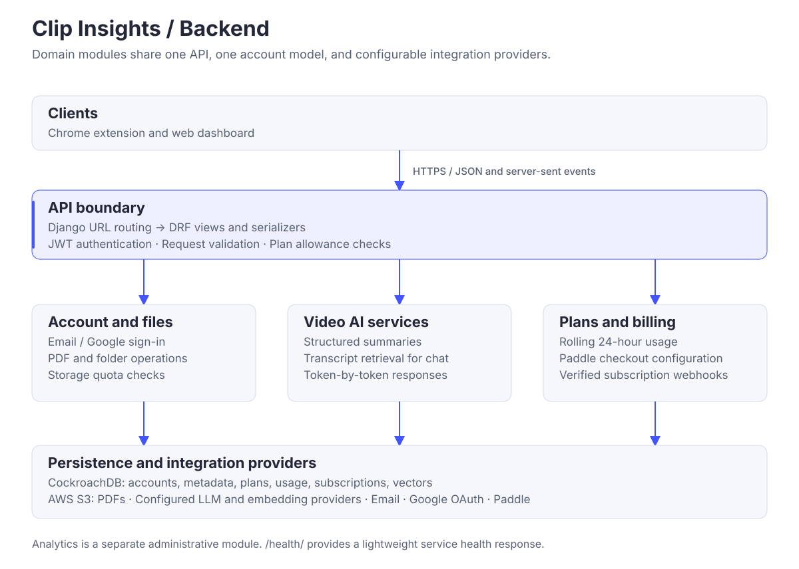
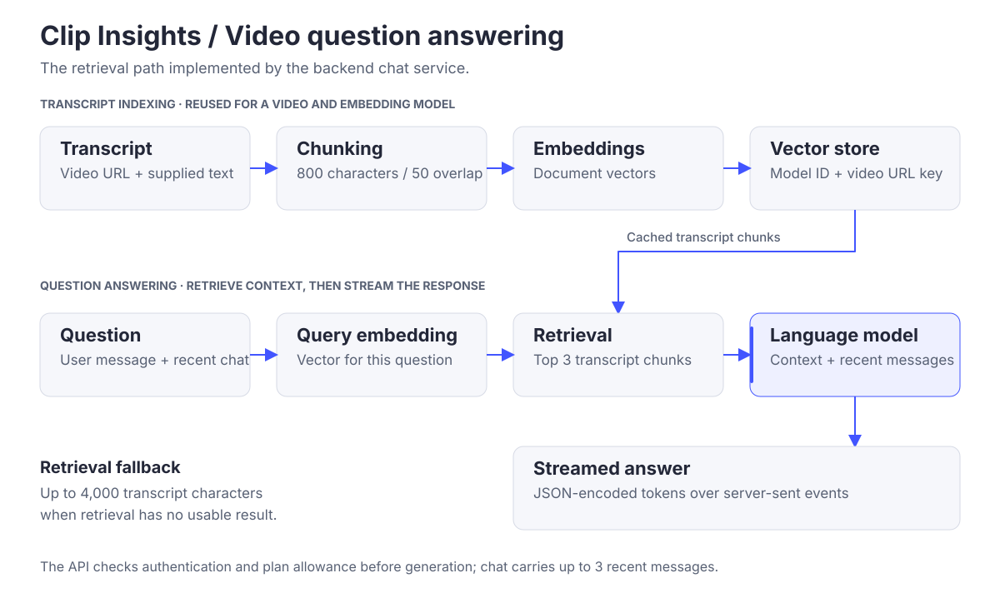

# Backend architecture

The Clip Insights backend is a Python 3.13 application built with Django 6 and Django REST Framework. It serves the Chrome extension and web dashboard through a shared account model, document API, AI services, and plan system.

[System architecture](https://github.com/Clip-Insights/.github/blob/main/docs/ARCHITECTURE.md) · [Local setup](./README.md) · [Contributor standards](./AGENTS.md)

## Module boundaries

| Module | Responsibility |
| --- | --- |
| `core` | Django settings, root URL routing, ASGI application, and health endpoint. |
| `account` | Email/password and Google sign-in, verification emails, password reset, JWT sessions, and logout. |
| `videos` | Structured summaries, key points, transcript budgets, and streamed video chat. |
| `files` | PDF upload, file and folder operations, search, and storage usage. |
| `plans` | Plan definitions, user entitlements, rolling usage windows, and request allowances. |
| `billing` | Purchase catalog, checkout configuration, subscription state, cancellation, and Paddle webhooks. |
| `analytics` | GA4 ingestion and administrative reporting. |
| `integrations` | Interfaces, provider implementations, configuration, and lazy provider resolution. |
| `utils` | Shared logging utilities. |

Requests enter through `core/urls.py`. DRF views validate input, apply authentication and plan checks, and call domain services. External service clients are resolved through `integrations/registry.py`.

## API surface

Paths below are relative to the backend base URL.

| Area | Routes | Access |
| --- | --- | --- |
| Service health | `GET /health/` | Public. |
| Accounts | `/api/account/` | Sign-up and sign-in are public; account operations require the relevant credentials. |
| Summary and key points | `POST /api/videos/summary/` | Authenticated, subject to plan allowance. |
| Video chat | `POST /api/videos/chat/` | Authenticated, subject to plan allowance. |
| Transcript budget | `GET /api/videos/tokenlimit/` | Public; resolves the caller's plan or guest plan. |
| Files and folders | `/api/files/` | Authenticated, scoped by user. |
| Plan catalog | `GET /api/plans/` | Public. |
| Plan and usage | `GET /api/plans/me/` | Authenticated. |
| Billing catalog | `GET /api/billing/catalog/` | Public. |
| Subscription and checkout | `/api/billing/subscription/`, `checkout/`, `cancel/` | Authenticated. |
| Paddle notifications | `POST /api/billing/webhook/` | Validated by webhook signature. |

The video and file APIs are also mounted at `/api/textutils/` and `/api/userspace/`. Their Django application labels are `textutils` and `userspace`; directory names are `videos` and `files`.

## Summary generation

The client supplies the video URL, transcript, and slice timing. `SummaryView` validates the request, resolves the user's plan, checks summary allowance, and bounds the transcript to the plan's token budget.

`videos/services/summarize.py` requests structured output through the selected LLM provider. A Pydantic `VideoSummary` contains `summary: str` and `keypoints: list[str]`. Both views in the extension use this single response. Each summary request generates a result from the supplied transcript; successful responses record one summary usage event.

## Video question answering

`videos/services/chat.py` implements transcript retrieval and response streaming:

1. Accept the video URL, question, transcript, and conversation history.
2. Split usable transcript text into 800-character windows with 50-character overlap.
3. Resolve the embedding provider and vector store. The storage key combines embedding-model identity and video URL.
4. Index transcript chunks when that key has no stored vectors.
5. Embed the question and retrieve the three nearest chunks.
6. Send the retrieved excerpts with the question and up to three recent messages to `chat_stream`.
7. Yield JSON-encoded tokens as SSE `data:` events, followed by `[DONE]`.

The system prompt is separate from the conversation messages. Retrieved excerpts are placed in the final user message by `build_chat_user_message`; prior turns retain their user/assistant roles.

When retrieval returns no usable result or a provider/store call fails, the service uses up to 4,000 characters of the supplied transcript as context. The LLM can also answer general questions; answers are not restricted to quotations from the video. A completed chat stream records a usage event. Provider failures are logged and returned through the stream.

The Cockroach vector-store adapter uses Django's database connection. Its `video_transcript_chunks` table stores content, chunk position, and vectors, with cosine-distance ordering for similarity search. Vector dimensions come from the embedding result.

## Accounts and sessions

`account.User` uses a UUID primary key and email as the login identifier. Email/password registration creates an inactive account and sends a verification link. Google sign-in validates a Google ID token through the OAuth provider.

DRF SimpleJWT issues access and refresh tokens. Access tokens last five minutes and refresh tokens last seven days. Logout blacklists the refresh token. Clients manage access-token renewal and retry; authorization decisions remain on the backend. Django's built-in staff, superuser, and model-permission system controls administrative access.

## Plans and usage

`Plan` stores feature allowances, transcript budgets, note/screenshot caps, storage limits, and per-file limits. `UserPlan` assigns a plan and optional expiry to an account. Anonymous callers resolve to the guest plan; authenticated callers resolve to an active, unexpired entitlement or the free plan.

AI allowance is measured over a rolling 24-hour window using `UsageEvent` rows. The API returns used, limit, remaining, and reset time. A depleted allowance produces a structured HTTP 429 response with a reason and an upgrade or wait action. Note and screenshot caps are supplied by this API and applied in the extension, where that working data lives.

## Documents and persistence

The `files` module stores PDF objects in AWS S3 and metadata in CockroachDB. Upload requests require authentication, a PDF content type, available account storage, and a permitted file size. File and folder queries are filtered by the requesting user.

Storage usage is the sum of saved file sizes; the allowance comes from the user's effective plan. File deletion removes both the object and metadata. Folder deletion removes contained documents and reports partial failures when an object cannot be deleted.

| Data | Location |
| --- | --- |
| Accounts and verification state | CockroachDB. |
| Files, folders, and document metadata | CockroachDB. |
| PDF document objects | AWS S3. |
| Plans, usage events, and subscriptions | CockroachDB. |
| Retrieved transcript chunks and vectors | CockroachDB vector-store table. |
| Working notes and screenshots | Browser IndexedDB, managed by the extension. |

## Billing

The web app reads the plan and billing catalogs, requests checkout configuration, and opens Paddle checkout. Payment credentials and signature verification stay in the backend integration.

Verified `subscription.*` notifications update `billing.Subscription` and `plans.UserPlan` in a database transaction. Active or trialing subscriptions apply the mapped plan, with a two-day renewal grace period after the billing period. Other subscription states resolve the account to the free plan. Cancellation can be scheduled for the current period's end.

## Integration configuration

The registry maps service capabilities to provider classes and creates instances lazily. Protocols define the operations expected from each provider. Selection is controlled by environment variables, so domain services depend on capabilities rather than vendor clients.

| Capability | Selection | Purpose |
| --- | --- | --- |
| Language model | `LLM_PROVIDER` | Fireworks AI or Gemini; `noop` supports tests. |
| Embeddings | `EMBEDDING_PROVIDER` | Vector representation for transcript retrieval. |
| Vector store | `VECTORSTORE_PROVIDER` | CockroachDB or in-memory test store. |
| Document storage | `STORAGE_PROVIDER` | S3 upload and deletion. |
| Email | `EMAIL_PROVIDER` | SMTP, Resend, or console output. |
| OAuth | `OAUTH_PROVIDER` | Google ID-token verification. |
| Billing | `PAYMENT_PROVIDER` | Paddle or test provider. |
| Analytics | `ANALYTICS_PROVIDER` | GA4 or no-op provider. |

Model IDs, credentials, and tuning values are read from environment configuration. Fireworks and Gemini are selectable LLM providers; selecting Gemini is a configuration choice, not an automatic failover mechanism.

Retired transcription and embedding integration code is outside the supported API surface. The extension reads captions through its platform adapter; there is no public audio-transcription route.

## Runtime and verification

The Docker build installs dependencies into a virtual environment, collects static assets, and packages the application with the database CA certificate. The container runs as a non-root user and starts Django's ASGI application through Uvicorn. Cloud Run supplies the listening port; `/health/` returns a lightweight health response.

Configuration lives in `core/settings.py`; environment loading uses `python-dotenv`. The development settings include permissive CORS and host handling. Deployment settings and credentials should be reviewed for the target environment.

Tests use pytest and pytest-django. Provider doubles and an in-memory vector store isolate AI and payment calls. See the [README](./README.md) for setup and test commands.
