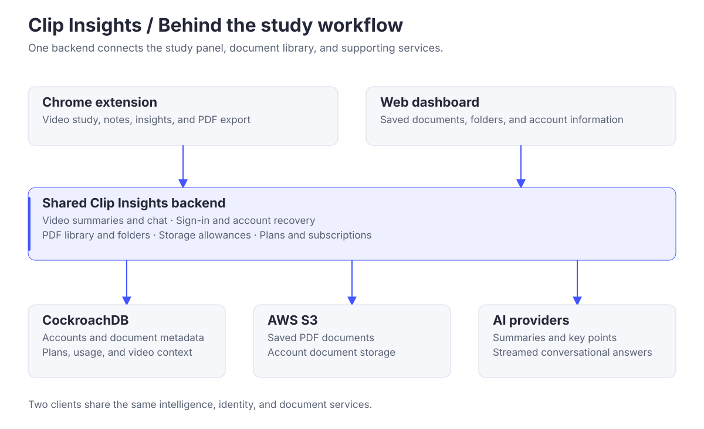
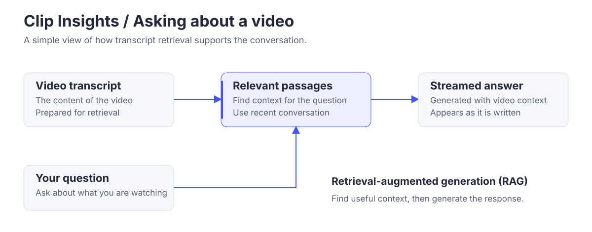

# Clip Insights · Backend

### Shared intelligence, accounts, and storage.

The backend connects the Clip Insights Chrome extension and web dashboard. It turns video transcripts into useful insights and manages the documents and accounts behind the study workflow.

[Project overview](https://github.com/Clip-Insights) · [Website](https://clipinsights.org) · [Web app](https://app.clipinsights.org)

## What it powers

| Area | Role in the product |
| --- | --- |
| Video understanding | Generate summaries and key points, and stream answers about a video. |
| Accounts | Email and Google sign-in, verification, and account recovery. |
| Study library | Store PDFs, organize files and folders, and track available space. |
| Plans and subscriptions | Apply account allowances and manage billing state. |

## How it fits together



The extension and dashboard share one backend. CockroachDB stores accounts and document metadata, while S3 holds saved PDFs. AI providers generate responses from the transcript context supplied by the study tools.

## How video chat finds context



Retrieval-augmented generation (RAG) finds relevant passages from the video transcript for each question. Those passages and the recent conversation provide context for an answer that appears as it is generated.

## Built with

**Python 3.13 · Django 6 · Django REST Framework · CockroachDB · AWS S3**

Language-model providers are configurable, including Fireworks AI and Google Gemini. The application runs in a Docker container with Uvicorn and targets Google Cloud Run.

## Run locally

Use Python 3.13 and uv. Configure the database and service credentials using the [development guide](./docs/DEVELOPMENT.md), then run:

```bash
uv sync
uv run python manage.py migrate
uv run python manage.py runserver
```

Run `uv run pytest` for the test suite.

## Explore further

[Detailed architecture](./ARCHITECTURE.md) · [Configuration and verification](./docs/DEVELOPMENT.md) · [Contributing](./AGENTS.md)

Part of [Clip Insights](https://github.com/Clip-Insights): [Chrome extension](https://github.com/Clip-Insights/chrome-extension) · [web app](https://github.com/Clip-Insights/web-app) · [public website](https://github.com/Clip-Insights/main-site).
